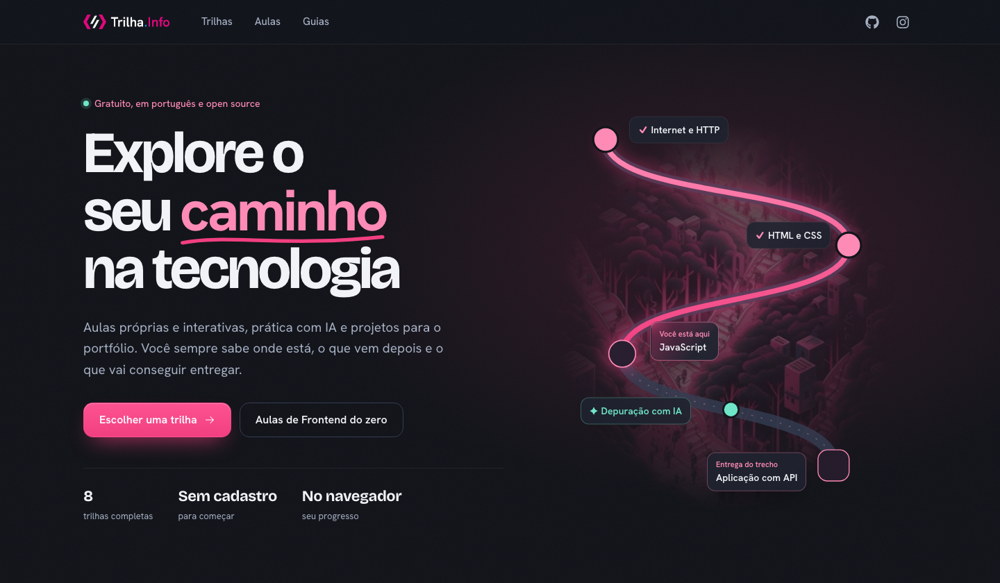

# Trilha Info

[Visit the platform](https://trilha.info) · [Português](../README.md) · [How to contribute](../CONTRIBUTING.md) · [Discord](https://discord.gg/TmneeHgTBp)

**Trilha Info** is an open source platform for learning technology through free content in Portuguese, organized into practical learning paths. Created in June 2022, it brings together career roadmaps, original interactive lessons, quick guides, and portfolio projects.

The current catalog includes **8 roadmaps, 8 courses, 76 lessons, and 34 guides**. You can start without an account and pick up where you left off, with progress saved in your browser.



_Screenshot of the local version taken on October 19, 2026._

## What you will find

- **A path for each career:** fundamentals, verifiable practice, and sections that lead to projects with completion criteria. Optional deep dives appear separately from the essential path.
- **Three ways to study:** Map (Mapa), Study (Estudar), and List (Lista) use the same catalog and share progress. You can search by topic, see the next step, and choose essential, complete, or in-depth coverage for each topic.
- **Interactive lessons in every roadmap:** explanations, diagrams, step-by-step execution, questions with feedback, ordering, classification, and code completion exercises.
- **Browser labs:** HTML, CSS, JavaScript, and React with a preview; SQLite queries; Python with Pyodide; and a guided terminal with simulated commands and output. The React and Python environments load external dependencies on demand.
- **Spaced repetition:** review cards are added to your deck as you complete lessons. Lessons shared across courses reuse the same progress.
- **Quick guides:** 34 references with examples and diagrams covering the web, APIs, security, data, testing, operations, careers, and collaboration.
- **AI throughout learning:** tutoring, prompting, debugging, pair programming, and small tasks for agents, with adaptable prompts and result verification.
- **Study plans:** local planning based on your goals and availability, context export for an external assistant, and plan import with validation, review, and an undo option.
- **Community participation:** the “Suggest content” (Sugerir conteúdo) button submits resources or new steps for review through a pull request when the integration is configured.
- **Developer mode:** enable the `</>` button in the footer and use “Code” (Código) on components to explore explanations, sources, CSS, data, and `fetch` requests recorded during use.

Study progress, preferences, plans, and reviews are stored in `localStorage` in the browser you use. Exporting your study context lets you take the catalog and your roadmap progress to an assistant of your choice. The application also lets you download a roadmap visualization as a PNG.

## Available roadmaps

The curriculum was revised in October 2026, with Portuguese resources as the foundation and language labels on specialized references.

| Roadmap                                                       | Path                                                                                        |
| ------------------------------------------------------------- | ------------------------------------------------------------------------------------------- |
| [Frontend](https://trilha.info/roadmap/frontend)              | Web, HTML, CSS, accessibility, JavaScript, TypeScript, interfaces, testing, and deployment. |
| [Backend](https://trilha.info/roadmap/backend)                | HTTP, programming, SQL, APIs, authentication, testing, and operations.                      |
| [Fullstack](https://trilha.info/roadmap/fullstack)            | Interface, server, and database integrated into a product, with security and delivery.      |
| [Testing / QA](https://trilha.info/roadmap/test)              | Risks, exploration, bug reporting, APIs, SQL, automation, and CI.                           |
| [DevOps](https://trilha.info/roadmap/devops)                  | Linux, networking, scripts, containers, CI/CD, infrastructure, and observability.           |
| [Data Engineering](https://trilha.info/roadmap/data-engineer) | Python, SQL, modeling, pipelines, transformation, orchestration, and governance.            |
| [React](https://trilha.info/roadmap/react)                    | Specialization in components, state, Effects, routing, data, testing, and performance.      |
| [Interviews](https://trilha.info/roadmap/entrevistas)         | Project presentations, coding, debugging, algorithms, and career-specific mock interviews.  |

To get started, choose a [roadmap](https://trilha.info/#trilhas), open the [courses and lessons](https://trilha.info/aulas), or browse the [guides](https://trilha.info/guias). Projects and exercises accompany the content; completing a reference and demonstrating a skill are tracked separately.

## Run locally

Use **Node.js 24** and **Yarn Classic 1.x** or npm. The repository contains both `yarn.lock` and `package-lock.json`; use your chosen package manager consistently. This update is validated with Node.js 24.

```sh
git clone https://github.com/flaviojmendes/trilhainfo.git
cd trilhainfo
yarn install --frozen-lockfile
yarn dev
```

With npm, the equivalent commands are `npm ci` and `npm run dev`.

Open [localhost:5173](http://localhost:5173). Roadmaps, lessons, guides, local progress, and planning work **without configuring an API or environment variables**.

### Optional integrations

Account, profile, notes, and custom roadmap creation/editing flows use Auth0 and the external API. To use them, configure the URLs in `.env.local` and allow the local origin in the Auth0 callbacks:

```dotenv
VITE_API_URL=https://api.trilha.info/api
VITE_PUBLIC_URL=https://api.trilha.info/public
```

Content suggestions use the `/api/contributions` and `/api/link-info` endpoints, served by Vite itself during development and by the functions in `api/` on Vercel.

| Variable                                  | Purpose                                                                    |
| ----------------------------------------- | -------------------------------------------------------------------------- |
| `VITE_TURNSTILE_SITE_KEY`                 | Public key for the Turnstile challenge in the form.                        |
| `TURNSTILE_SECRET_KEY`                    | Server-side challenge validation.                                          |
| `GITHUB_APP_ID`, `GITHUB_APP_PRIVATE_KEY` | Credentials for the GitHub App that opens pull requests; server-side only. |
| `GITHUB_APP_INSTALLATION_ID`              | App installation; can be discovered automatically when omitted.            |
| `CONTRIBUTIONS_REPOSITORY`                | Target repository; defaults to `flaviojmendes/trilhainfo`.                 |
| `CONTRIBUTIONS_BASE_BRANCH`               | Target branch; defaults to `main`.                                         |
| `SITE_URL`                                | Public origin used by the server to fetch the catalog.                     |

Without a GitHub App, local development returns a simulation and the suggestion JSON without opening a pull request. In production on Vercel, submissions require GitHub App and Turnstile configuration. See the [suggestion format](../src/contributions/entries/README.md).

To run Vite with an alternative configuration directory, set `TRILHA_ENV_DIR`. An empty directory lets you validate the catalog and frontend without loading the local configuration.

### Docker

The existing Compose configuration maps port `80` on the host to port `3000` in the container. Pass that port to Vite:

```sh
docker compose run --build --rm --service-ports trilha-info-front yarn dev --host 0.0.0.0 --port 3000
```

Open [localhost](http://localhost). This container runs the development server.

## Commands and validation

| Command           | What it does                                                             |
| ----------------- | ------------------------------------------------------------------------ |
| `yarn dev`        | Starts Vite with the catalogs and local endpoints.                       |
| `yarn check`      | Checks types in the frontend, scripts, and server.                       |
| `yarn test`       | Runs Vitest in watch mode.                                               |
| `yarn test:run`   | Runs the test suite once.                                                |
| `yarn coverage`   | Generates test coverage.                                                 |
| `yarn build`      | Checks types and builds the application and public artifacts in `dist/`. |
| `yarn preview`    | Serves the build locally for inspection.                                 |
| `yarn format:all` | Formats the repository with Prettier.                                    |
| `yarn icons`      | Regenerates the application icons.                                       |

Before submitting a change, run:

```sh
yarn check
yarn test:run
yarn build
```

The suite covers curriculum integrity, the catalog and IDs, progress and migration, study plans, lessons and labs, guides, contributions, developer mode, and interface components.

## Stack and organization

The frontend uses **React 18, TypeScript, Vite, React Router, Tailwind CSS, Radix UI, and Framer Motion**. Tests use **Vitest and Testing Library**. Labs include **sql.js/SQLite and Pyodide**; authentication uses **Auth0**. Vite plugins generate the public catalog and sharing previews.

```text
src/
  pages/                 Pages and routes
  components/            Interface, study workspace, and labs
  roadmaps/              Curriculum, resources, projects, and AI practices
  learning/              Catalog, progress, migration, plans, and contracts
  lessons/               Metadata, lesson content, courses, and review
  guides/                Guide metadata and content
  contributions/         Validation and community content suggestions
  devmode/               Component inspection within the platform
api/                     Function entry points for Vercel
server/                  GitHub integration and suggestion processing
scripts/                 Vite plugins and artifact generation
docs/                    Editorial decisions and technical documentation
public/                  Images, icons, and static content
```

The main routes are `/`, `/roadmap/:name`, `/aulas`, `/aulas/:trilha`, `/aula/:lesson`, `/guias`, and `/guide/:guide`. `/hroadmap/:name` opens the same study workspace. Routes for the blog, external courses, profiles, and custom roadmaps also remain in the application.

### Public catalog and agents

Editorial content is maintained in `src/roadmaps/`. The build generates the following formats from that source; they are also available during `yarn dev`:

| Public path                             | Content                                                   |
| --------------------------------------- | --------------------------------------------------------- |
| `/data/index.json`                      | Catalog index.                                            |
| `/data/<trilha>.json`                   | Structured catalog, with IDs and dependencies.            |
| `/data/<trilha>.md`                     | Markdown content with practices, prompts, and references. |
| `/read/<trilha>/`                       | Complete roadmap readable without JavaScript.             |
| `/schemas/roadmap.v1.schema.json`       | Catalog contract.                                         |
| `/schemas/study-context.v1.schema.json` | Exported study context contract.                          |
| `/schemas/study-plan.v1.schema.json`    | Contract for importable plans.                            |
| `/llms.txt`, `/sitemap.xml`             | Discovery by agents and search engines.                   |

When hosting, serve existing files before the SPA fallback and keep the `/api/` handlers when using suggestions. `yarn preview` serves the static build; the local endpoint plugin runs only during development.

## Contributing

You can suggest resources through the application, [report an issue](https://github.com/flaviojmendes/trilhainfo/issues), or submit a pull request. For larger changes, open an issue to discuss your proposal. See the [contribution guide](../CONTRIBUTING.md).

When editing the curriculum, preserve editorial IDs, prerequisite order, verifiable practice, and project completion criteria. Indicate the language of resources and whether they are free. Lessons live in `src/lessons/` and guides in `src/guides/`.

Courses are derived from the roadmaps. When changing the mapping between lessons and topics, regenerate and check `src/lessons/courses.ts`:

```sh
UPDATE_COURSES=1 yarn test:run src/lessons/courses.test.ts
```

Supporting documentation:

- [October 2026 roadmap review](../docs/revisao-trilhas-2026-10.md).
- [Learning programming with AI assistance](../docs/aprender-com-ia.md).
- [Adaptive roadmaps and agent contracts](../docs/aplicativo-adaptativo.md), with an [English version](../docs/adaptive-learning.en.md).
- [Community suggestion format and review](../src/contributions/entries/README.md).

Meet [the contributors](https://github.com/flaviojmendes/trilhainfo/graphs/contributors) and join the [Discord community](https://discord.gg/TmneeHgTBp).

## License

The repository's [LICENSE](../LICENSE) file contains the **Apache 2.0** license. Generated catalogs declare **MIT** in their metadata. External resources retain their own licenses.
